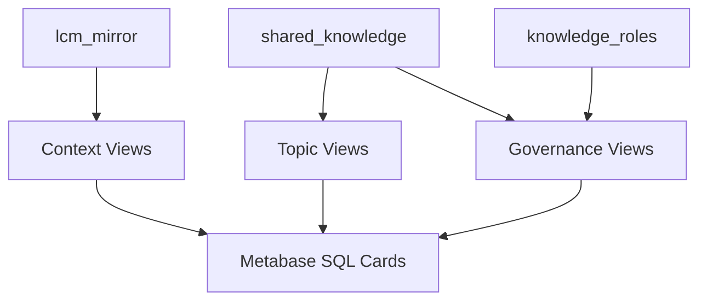

# toB Dashboard v1 PostgreSQL Specification

This document describes the current local `lcm_demo` PostgreSQL schema used by
the toB dashboard v1 demo. It records the table/view definitions, column data
types, text storage characteristics, current demo-data statistics, Metabase SQL
card mapping, and a roadmap for a future PostgreSQL `md` Markdown data type.

Snapshot source: local `lcm_demo`, `public` schema, inspected after importing the
current demo dataset.

## Scope

The current dashboard schema contains:

- 3 public tables:
  - `lcm_mirror`
  - `shared_knowledge`
  - `knowledge_roles`
- 6 public views:
  - `vw_context_shift_hourly`
  - `vw_context_volume_daily`
  - `vw_topic_trends_daily`
  - `vw_topic_momentum_7d`
  - `vw_governance_visibility_daily`
  - `vw_governance_role_matrix`
- Metabase SQL card queries under `sql/tob-dashboard/metabase/v1/`

Local generated CSV files are intentionally outside this specification and must
remain local-only artifacts.

## Table Definitions

### `lcm_mirror`

Stores captured Agent mirror snapshots. One row represents the observed context
state for an Agent conversation at a capture time.

| Column | Type | Nullable | Default | Notes |
|---|---:|---:|---|---|
| `mirror_id` | `uuid` | no | `gen_random_uuid()` | Primary key |
| `session_key` | `text` | no | | Stable session key |
| `conversation_id` | `bigint` | no | | Conversation identifier |
| `agent_id` | `text` | no | | Agent slug, e.g. `main`, `infra`, `finance`, `security`, `product` |
| `mode` | `text` | no | `'latest_nodes'::text` | Snapshot mode |
| `content` | `text` | no | | Main human-readable mirror text |
| `summary_ids` | `jsonb` | no | `'[]'::jsonb` | JSON array of summary identifiers |
| `content_hash` | `text` | no | | Deduplication hash |
| `session_id` | `text` | yes | | Optional session id |
| `captured_at` | `timestamptz` | no | | When the snapshot was captured |
| `ingested_at` | `timestamptz` | no | `now()` | When the snapshot was written to PostgreSQL |

Constraints and indexes:

| Name | Type | Definition |
|---|---|---|
| `lcm_mirror_pkey` | primary key | `mirror_id` |
| `lcm_mirror_conversation_id_content_hash_key` | unique | `(conversation_id, content_hash)` |
| `lcm_mirror_session_key_idx` | btree | `(session_key, ingested_at DESC)` |
| `lcm_mirror_agent_idx` | btree | `(agent_id, ingested_at DESC)` |

### `shared_knowledge`

Stores curated knowledge extracted from Agent work. Rows are more stable and
structured than mirror snapshots: titles, tags, visibility, and role-based access
metadata are first-class fields.

| Column | Type | Nullable | Default | Notes |
|---|---:|---:|---|---|
| `knowledge_id` | `uuid` | no | | Primary key |
| `owner_agent_id` | `text` | no | | Owning Agent slug |
| `visibility` | `text` | no | `'shared'::text` | Must be `shared`, `restricted`, or `private` |
| `visible_to` | `text[]` | no | `'{}'::text[]` | Roles allowed to read restricted entries |
| `editable_by` | `text[]` | no | `'{}'::text[]` | Roles allowed to edit |
| `title` | `text` | yes | | Short human-readable title |
| `content` | `text` | no | | Main knowledge body |
| `source_mirror_ids` | `uuid[]` | no | `'{}'::uuid[]` | Optional source snapshot references |
| `tags` | `text[]` | no | `'{}'::text[]` | Topic tags |
| `created_at` | `timestamptz` | no | `now()` | Creation time |
| `updated_at` | `timestamptz` | no | `now()` | Last update time |

Constraints and indexes:

| Name | Type | Definition |
|---|---|---|
| `shared_knowledge_pkey` | primary key | `knowledge_id` |
| `shared_knowledge_visibility_check` | check | `visibility IN ('shared', 'restricted', 'private')` |
| `sk_visibility_idx` | btree | `(visibility, updated_at DESC)` |
| `sk_owner_idx` | btree | `(owner_agent_id, updated_at DESC)` |
| `sk_tags_idx` | GIN | `tags` |
| `sk_visible_to_idx` | GIN | `visible_to` |
| `sk_editable_by_idx` | GIN | `editable_by` |

### `knowledge_roles`

Stores role grants for Agents. The table is used by governance views to evaluate
readable/editable knowledge counts.

| Column | Type | Nullable | Default | Notes |
|---|---:|---:|---|---|
| `agent_id` | `text` | no | | Agent slug |
| `role` | `text` | no | | Role slug |
| `granted_at` | `timestamptz` | no | `now()` | Grant timestamp |

Constraints and indexes:

| Name | Type | Definition |
|---|---|---|
| `knowledge_roles_pkey` | primary key | `(agent_id, role)` |
| `kr_role_idx` | btree | `role` |

## Column Type Reference

| Type | Used By | Purpose |
|---|---|---|
| `text` | Agent IDs, roles, titles, hashes, long content | General string storage |
| `jsonb` | `lcm_mirror.summary_ids` | Structured JSON array of summary identifiers |
| `text[]` | `visible_to`, `editable_by`, `tags` | Role and tag arrays with GIN indexes |
| `uuid[]` | `source_mirror_ids` | Optional references to mirror snapshots |
| `uuid` | Primary keys | Stable row identity |
| `bigint` | `conversation_id` | Conversation identity |
| `timestamptz` | event timestamps | Timezone-aware capture, ingest, create, update, grant times |

## Large Text Storage

The current schema does not use binary large objects, PostgreSQL large objects,
or `bytea` blobs. Large human-readable values are stored as PostgreSQL `text`.

Large-document columns:

| Table | Column | Type | Role |
|---|---|---:|---|
| `lcm_mirror` | `content` | `text` | Agent mirror snapshot body |
| `shared_knowledge` | `content` | `text` | Curated knowledge body |

Short text columns such as `shared_knowledge.title`, `agent_id`, `role`,
`content_hash`, and `session_key` are also `text`, but they are not document
body fields.

PostgreSQL `text` is logically a string type. For sufficiently large values,
PostgreSQL can use TOAST storage internally to compress and/or store values out
of line. That storage detail is transparent to SQL callers.

## Current Demo Data Statistics

Current imported demo data:

| Table | Rows |
|---|---:|
| `lcm_mirror` | 300 |
| `shared_knowledge` | 60 |
| `knowledge_roles` | 8 |

`lcm_mirror` distribution:

| Agent | Rows |
|---|---:|
| `finance` | 60 |
| `infra` | 60 |
| `main` | 60 |
| `product` | 60 |
| `security` | 60 |

`shared_knowledge.visibility` distribution:

| Visibility | Rows |
|---|---:|
| `shared` | 36 |
| `restricted` | 15 |
| `private` | 9 |

Text/string statistics:

| Column | Rows | Avg Bytes | Max Bytes | Avg Chars | Max Chars |
|---|---:|---:|---:|---:|---:|
| `lcm_mirror.content` | 300 | 319.9 | 462 | 118.7 | 177 |
| `shared_knowledge.content` | 60 | 258.6 | 296 | 91.6 | 108 |
| `shared_knowledge.title` | 60 | 30.1 | 39 | 11.8 | 23 |

Table storage footprint:

| Relation | Total Size |
|---|---:|
| `lcm_mirror` | 448 kB |
| `shared_knowledge` | 256 kB |
| `knowledge_roles` | 48 kB |

These values describe the current local demo dataset only. They should not be
treated as production sizing guidance.

## View Definitions and Purpose

Views are defined in `sql/tob-dashboard/v1_views.sql`.

### `vw_context_shift_hourly`

Purpose: hourly context-shift score by Agent.

Inputs:

- `lcm_mirror.content`
- `lcm_mirror.summary_ids`
- `lcm_mirror.conversation_id`
- `lcm_mirror.captured_at`

Core logic:

- Computes current content length and summary node count.
- Uses `lag(...) OVER (PARTITION BY conversation_id ORDER BY captured_at, mirror_id)` to compare each snapshot with the previous snapshot in the same conversation.
- Calculates:
  - `content_delta_ratio`
  - `node_delta_ratio`
  - weighted shift score: `content_delta_ratio * 0.7 + node_delta_ratio * 0.3`
- Aggregates by `bucket_hour` and `agent_id`.

Outputs include `snapshots`, `active_conversations`, `avg_content_chars`,
`avg_summary_nodes`, `shift_score_avg`, and `shift_score_peak`.

### `vw_context_volume_daily`

Purpose: daily volume and size trends by Agent.

Aggregates `lcm_mirror` by `date_trunc('day', captured_at)` and `agent_id`.
Outputs snapshot count, active conversation count, average content length, p95
content length, and average summary node count.

### `vw_topic_trends_daily`

Purpose: daily topic/tag trend aggregation.

Expands `shared_knowledge.tags` with `unnest(tags)`, normalizes tags with
`lower(trim(tag))`, and aggregates entries by day and tag. Tracks shared,
restricted, and private entry counts plus distinct owner count.

### `vw_topic_momentum_7d`

Purpose: compare recent 7-day topic activity with the previous 7-day window.

Uses the max `shared_knowledge.updated_at` day as an anchor, then computes
`recent_7d`, `previous_7d`, `delta_7d`, and `growth_ratio` by tag.

### `vw_governance_visibility_daily`

Purpose: daily governance mix by knowledge visibility.

Aggregates `shared_knowledge` by update day and outputs total entries, shared
entries, restricted entries, private entries, and `restricted_ratio`.

### `vw_governance_role_matrix`

Purpose: role-based readability/editability matrix.

Crosses `knowledge_roles` with `shared_knowledge` to compute:

- `readable_entries`
- `editable_entries`
- `restricted_readable_entries`

Readability logic includes shared entries, restricted entries visible to the
role, and entries owned by the Agent.

## Metabase SQL Card Mapping

The Metabase SQL pack lives under `sql/tob-dashboard/metabase/v1/`.

| File | Suggested Card | Primary Source |
|---|---|---|
| `01_kpi_overview.sql` | KPI Overview | `lcm_mirror`, `shared_knowledge`, `knowledge_roles`, `vw_context_shift_hourly` |
| `02_context_shift_trend.sql` | Context Shift Trend by Agent | `vw_context_shift_hourly` |
| `03_context_volume_daily.sql` | Context Volume Daily | `vw_context_volume_daily` |
| `04_context_latest_snapshots.sql` | Latest Mirror Snapshots | `lcm_mirror` |
| `05_topic_top_tags_30d.sql` | Top Topic Tags (30d) | `vw_topic_trends_daily` |
| `06_topic_daily_trend_top8.sql` | Topic Daily Trend (Top 8) | `vw_topic_trends_daily` |
| `07_topic_momentum_7d.sql` | Topic Momentum (7d) | `vw_topic_momentum_7d` |
| `08_governance_visibility_daily.sql` | Governance Visibility Mix | `vw_governance_visibility_daily` |
| `09_governance_role_matrix.sql` | Governance Role Matrix | `vw_governance_role_matrix` |
| `10_recent_curated_knowledge.sql` | Recent Curated Knowledge | `shared_knowledge` |

Optional Chinese-alias examples are available under
`sql/tob-dashboard/metabase/v1/zh/`. They are examples for manual Metabase card
creation and do not automatically rename existing Metabase cards.

## Data Flow



## Future Roadmap: `md` Markdown Data Type

The current schema stores Markdown-like or narrative content as plain `text`.
That is sufficient for storage and display, but it does not let PostgreSQL
understand Markdown structure such as headings, sections, links, and code blocks.

The proposed `md` type is a future PostgreSQL extension direction:

```sql
CREATE TABLE docs (
  id uuid PRIMARY KEY,
  body md NOT NULL
);
```

### Design Goals

- Store Markdown documents in table cells.
- Preserve original Markdown text for round-trip fidelity.
- Provide functions to read content by heading/section.
- Provide table-valued functions for table of contents and section metadata.
- Support future full-text search over all content or selected sections.

### Storage Model

Recommended first implementation:

- Logical type: `md`
- Physical payload: raw Markdown text
- Parser: CommonMark/GFM-compatible parser in the extension layer
- Optional future cache: parsed headings/section offsets or generated helper
  tables/indexes

Storing raw Markdown first avoids losing formatting details and reduces migration
risk when parser behavior changes.

### Candidate SQL API

| Function | Purpose |
|---|---|
| `md_valid(doc md) RETURNS boolean` | Check that a value can be parsed |
| `md_toc(doc md)` | Return headings with level, title, path, and position |
| `md_section(doc md, path text) RETURNS text` | Return the body under a heading path |
| `md_has_header(doc md, header text) RETURNS boolean` | Test whether a heading exists |
| `md_plaintext(doc md) RETURNS text` | Strip Markdown markup for display/search |
| `md_tsvector(doc md) RETURNS tsvector` | Build full-text search vector |
| `md_links(doc md)` | Return Markdown links |
| `md_code_blocks(doc md)` | Return fenced/indented code blocks |
| `md_frontmatter(doc md)` | Return frontmatter if present |

Example target usage:

```sql
SELECT md_toc(content)
FROM shared_knowledge
WHERE knowledge_id = '...';

SELECT md_section(content, '风险/缓解措施')
FROM shared_knowledge
WHERE knowledge_id = '...';

SELECT knowledge_id, title
FROM shared_knowledge
WHERE md_has_header(content, '结论');
```

### Adoption Strategy for LCM-PG

Recommended order:

1. Prototype the extension API on a separate `docs(body md)` or test table.
2. Add optional generated/query functions without changing current dashboard
   behavior.
3. Evaluate `shared_knowledge.content` as the first adoption target because it is
   curated and naturally section-oriented.
4. Evaluate `lcm_mirror.content` later. Mirror rows are event snapshots and may be
   less consistently structured than curated knowledge.

### Migration Sketch

Early migration can be conservative:

```sql
ALTER TABLE shared_knowledge
  ADD COLUMN content_md md;

UPDATE shared_knowledge
SET content_md = content::md;
```

Only after API and performance behavior are stable should the canonical column
move from `content text` to `content md`.

### Open Design Questions

- Should `md` be implemented in C, Rust via `pgrx`, or as a SQL/domain prototype
  first?
- Should section lookup be path-based (`'方案/风险'`), id-based, or both?
- Should heading paths be case-sensitive?
- How should duplicate headings under the same parent be addressed?
- What index operator class is needed for section-level search?
- Should frontmatter be parsed as YAML/JSON, or exposed as raw text first?

## Operational Notes

- Metabase does not automatically create cards from repository SQL files. SQL
  files under `sql/tob-dashboard/metabase/v1/` must be manually pasted/saved as
  Metabase Questions or created through the Metabase API.
- Metabase card titles and dashboard layout live in Metabase's application
  database, not in this repository.
- Local generated data under demo-local directories should not be committed.
